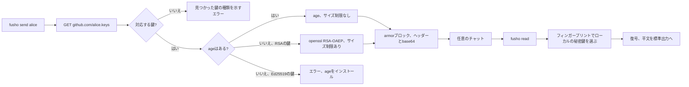

<div align="center">

<h1>fusho</h1>

<strong>GitHubのユーザー名を宛先にして、どのチャットでも暗号化したメッセージを送れます。</strong>

[English](README.md) | 日本語 | [简体中文](README.zh-Hans.md) | [繁體中文 (香港)](README.zh-HK.md)

[](https://github.com/gufranco/fusho/actions/workflows/ci.yml)
[](https://github.com/gufranco/fusho/releases)
[](LICENSE)
[](#development)
[](#portability)

<p align="center">
  <a href="#quick-start"><strong>クイックスタート</strong></a> |
  <a href="#how-it-works">仕組み</a> |
  <a href="#what-it-does-not-do"><strong>セキュリティ上の制限</strong></a> |
  <a href="#troubleshooting">トラブルシューティング</a>
</p>

</div>

コマンドは5つ、テストは161件、POSIX `sh`のファイル1つで動き、実行時に必要なのは`age`だけです。

> [!NOTE]
> **脅威モデル。** fushoは秘密をチャット履歴から守ります。保存ポリシー、誰も設定した覚えのないバックアップ、2031年にそのチャンネルを引き継ぐ同僚から守ります。キーロガー、国家機関、そして念のためにと暗号化ブロックのすぐ下に平文を貼る同僚からは守れません。それらは[できないこと](#what-it-does-not-do)に書いてあり、たいていはもっと大きな予算が必要です。

`fusho`は日本語の「封書」です。一人に宛てて封をし、その人だけが開ける手紙です。

---

```console
$ fusho send alice 'database password: correct-horse-battery-staple'
-----BEGIN FUSHO MESSAGE-----
v: 1
alg: age
to: alice
key: SHA256:iD5CQysP5Zu+ugBNVoQSDruYFlSFJSJiFQwUXbpdGh4

YWdlLWVuY3J5cHRpb24ub3JnL3YxCi0+IHNzaC1lZDI1NTE5IGlENUNReSBhWDNu
UjZQd2NCRWRhVGJZbUFVWjZHUUFEeUJIUGNZTFVoMkc5ZmVRR0ZzCg==
-----END FUSHO MESSAGE-----
fusho: copied to the clipboard with pbcopy.
```

これをすべてSlack、Telegram、Jiraのチケット、メールに貼り付けます。aliceはコマンドを1つ実行するだけです。

```console
$ pbpaste | fusho read
database password: correct-horse-battery-staple
```

GitHubのアカウントはすべて、SSH公開鍵を`github.com/<user>.keys`で公開しています。`fusho`はその鍵に向けて暗号化し、受信者は自分の`~/.ssh`にある秘密鍵で復号します。鍵の交換も、鍵サーバーも、アカウント作成も不要です。

ブロックの`BEGIN`より上には、初めて受け取った人に向けて、それが何でどう開くかを伝える短いメモが付きます。パーサーは`BEGIN`より上をすべて無視するので、このメモがメッセージを壊すことはありません。`--no-banner`または`FUSHO_BANNER=0`で消せます。

<a id="quick-start"></a>

## クイックスタート

### 前提条件

| ツール | 用途 | インストール |
|:-----|:----|:--------|
| POSIX `sh` | ツール本体 | どこにでもプリインストールされています。`bash`は不要です |
| `curl`、`ssh-keygen`、`openssl` | 鍵の取得、フィンガープリント、base64 | macOSとLinuxにプリインストールされています |
| [`age`](https://github.com/FiloSottile/age) | 暗号化エンジン | `brew install age`または`apt install age`。Homebrewのformulaが自動でインストールします |
| `qrencode` | 任意。`--qr`でのみ使います | `brew install qrencode`または`apt install qrencode` |

> [!IMPORTANT]
> `age`がない場合、fushoは`openssl`経由のRSAに切り替えます。この方法ではEd25519の鍵に暗号化できず、メッセージは470バイトまでに制限されます。GitHubのアカウントの多くはEd25519の鍵を公開しているので、`age`をインストールしてください。

### インストール

```bash
brew install gufranco/tap/fusho
```

formulaは[gufranco/homebrew-tap](https://github.com/gufranco/homebrew-tap)にあります。ソースからもインストールでき、その場合はmanページとシェル補完も入ります。

```bash
git clone https://github.com/gufranco/fusho.git
cd fusho
make install
```

各[リリース](https://github.com/gufranco/fusho/releases)にはそのまま実行できる`dist/fusho`も添付されているので、受信者はファイルを1つダウンロードし、読んでから実行できます。

### 確認

```console
$ fusho doctor
age            ok       v1.3.1
curl           ok
ssh-keygen     ok
openssl        ok       OpenSSL
identities     ok       1 usable key pair(s) under ~/.ssh
```

## 使い方

| コマンド | 用途 |
|:--------|:--------|
| `fusho send <user>[@host] [message]` | GitHub、GitLab、Codeberg、SourceHut、セルフホストのフォージのユーザーに暗号化します。メッセージを指定しない場合は標準入力を読みます |
| `fusho read [file]` | 復号します。パイプされていれば標準入力を、そうでなければクリップボードを読みます |
| `fusho keys <user>` | fushoが暗号化できる鍵をフィンガープリント付きで一覧表示します |
| `fusho doctor` | ローカル環境を確認し、失敗した項目ごとに対処法を表示します |
| `fusho version` | バージョンと使用中のエンジンを表示します |

| フラグ | 効果 |
|:-----|:-------|
| `--to <target>` | 受信者を追加します。複数人なら繰り返します |
| `--sign <you>` | 公開鍵の秘密鍵を持っているユーザーとして署名します |
| `--require-signature` | 読み込み時に、署名のないメッセージを拒否します |
| `--accept-new-key` | 固定した鍵が変わった受信者を受け入れます |
| `--expires <when>` | `30m`、`6h`、`7d`などの経過後にメッセージを期限切れにします |
| `--ignore-expiry` | 読み込み時に、送信者が期限切れにしたメッセージを開きます |
| `--key <prefix>` | フィンガープリントの接頭辞で選んだ1つの鍵だけに暗号化します |
| `--keys-file <path>` | ローカルの公開鍵ファイルから受信者を追加します |
| `--identity <path>` | 指定した秘密鍵で復号します |
| `--identity-command <cmd>` | コマンドから秘密鍵を読みます。シークレットマネージャーにある鍵向けです |
| `--json` | 機械が読める形式で出力します |
| `--qr` | メッセージをQRコードで出力します |
| `--no-banner` | ブロックの上のメモを省きます |
| `--no-clipboard` | 結果をクリップボードにコピーしません |

```bash
printf 'the secret' | fusho send alice          # stdin keeps it out of the process list
fusho send alice:iD5CQy 'only to that one key'  # pin one key by fingerprint prefix
fusho send bob@gitlab 'works across forges'     # gitlab, codeberg, sourcehut, self-hosted
fusho send --to alice --to bob@codeberg 'hi'    # one message, several people
fusho read                                      # with nothing piped, reads the clipboard
```

> [!TIP]
> 秘密は引数ではなく標準入力で渡してください。引数はプロセス一覧を通じて、そのマシンの全ユーザーから見えます。

### 鍵のホスト

| ホスト | 受信者の書き方 | 状態 |
|:-----|:-----------------|:-------|
| GitHub | `alice` | デフォルト |
| GitLab | `alice@gitlab` | 対応 |
| Codeberg | `alice@codeberg` | 対応 |
| SourceHut | `alice@sourcehut` | 対応 |
| セルフホストのGitea、Forgejo、GitLab | `alice@git.example.com` | `/<user>.keys`を提供するホストならどれでも |
| Bitbucket | 非対応 | 公開鍵のエンドポイントがないため、`--keys-file`を使ってください |

<a id="how-it-works"></a>

## 仕組み



| エンジン | 受信者の鍵 | サイズ制限 | 完全性 |
|:-------|:---------------|:-----------|:----------|
| `age`、インストールされていれば常に使用 | `ssh-ed25519`と`ssh-rsa` | 実質なし | 認証付き暗号 |
| `openssl`のフォールバック | `ssh-rsa`のみ | 4096ビットで470バイト、2048ビットで214バイト | 機密性のみ、完全性の確認なし |

フォールバックがあるので、何もインストールできない受信者でも短い秘密なら受け取れます。使われると`fusho send`が標準エラーに警告を出します。Ed25519の受信者と大きすぎるメッセージは、壊れたものを出力せずに拒否します。fushoは独自の暗号を実装せず、`age`か`openssl`に任せています。

### 署名

署名のないメッセージは機密ですが、送信者はわかりません。`--sign`は送信者がすでに公開しているSSH鍵でその穴を埋めます。

```console
$ fusho send alice --sign you 'this really is from me'

$ fusho read message.txt
fusho: signature verified against a key published by 'you'.
this really is from me
```

署名は暗号文を対象とし、`ssh-keygen -Y verify`で名乗った送信者の公開鍵と照合します。本文の改ざんや、`from:`を別人に差し替えたものは検証に失敗し、平文は表示されません。

### 鍵の固定

ある人への最初のメッセージで、その人のフィンガープリントを`${XDG_CONFIG_HOME:-~/.config}/fusho/known_recipients`に記録します。あとで鍵が変わると、送信は止まります。

```console
$ fusho send alice 'secret'
fusho: the keys published by alice changed since you last messaged them.
  pinned:  SHA256:Hb2u7V4cmzORXDF0QulbVVq83T/B6AfX+64LPZS64n0
  current: SHA256:6FV5K276oVndQJv5uxtytvD/KIrimmU/SmWvEgmmdIo
  a key rotation looks exactly like an account takeover from here.
  verify the fingerprint with them out of band, then re-run with --accept-new-key
```

<a id="what-it-does-not-do"></a>

## できないこと

> [!WARNING]
> **署名のないメッセージは、誰が送ったかを何も証明しません。** 公開鍵に向けて暗号化することは誰にでもでき、誰でも名乗れます。`--sign <you>`で署名するか、`--require-signature`で署名のないメッセージを拒否してください。

| 制限 | 詳細 |
|:------|:-------|
| 認証されないヘッダー | `to:`と`key:`の行はルーティング用の情報です。書き換えると身元のエラーになり、`age`が本文を認証しているので、誤った平文になることはありません |
| アカウントのすべての鍵で読める | 受信者はどの端末でも読めるので、メッセージの安全性は公開鍵のうち最も弱いものと同じです。`--key`で1つに固定してください |
| 信頼の起点はフォージ | 受信者のアカウントに鍵を追加できる人は、その後に送られたメッセージを読めます。鍵の固定により、気づかれない乗っ取りは送信の拒否に変わります |

<a id="troubleshooting"></a>

## トラブルシューティング

<details>
<summary><strong>decryption failedと出て、秘密鍵がBEGIN OPENSSH PRIVATE KEYで始まる</strong></summary>
<br>

PEM形式の鍵が必要なのは`openssl`のフォールバックだけです。同じ公開鍵のまま変換します。

```bash
ssh-keygen -p -m PEM -f ~/.ssh/id_rsa
```

</details>

<details>
<summary><strong>no local private key matches this messageと出る</strong></summary>
<br>

メッセージは、このマシンに秘密鍵がない鍵に宛てられています。fushoは必要な鍵のフィンガープリントを表示するので、自分の鍵と比べてください。

```bash
ssh-keygen -lf ~/.ssh/*.pub
```

</details>

<details>
<summary><strong>鍵が1Password、Secretive、その他のSSHエージェントにある</strong></summary>
<br>

`age`は鍵ファイルでしか復号できず、エージェントは秘密鍵を渡しません。代わりにシークレットマネージャーから鍵を渡してください。fushoは鍵を非公開の一時ファイルに書き、終了時に削除します。

```bash
pbpaste | fusho read --identity-command "op read 'op://Private/ssh-key/private key'"
```

</details>

<details>
<summary><strong>publishes no key fusho can encrypt toと出る</strong></summary>
<br>

そのアカウントにはECDSAの鍵しかなく、どちらのエンジンも対応していません。受信者にEd25519かRSAの鍵を頼んでください。

</details>

<details>
<summary><strong>まだ鍵ペアがない</strong></summary>
<br>

鍵を作成し、公開鍵を[github.com/settings/keys](https://github.com/settings/keys)に追加します。

```bash
ssh-keygen -t ed25519 -f ~/.ssh/id_ed25519
```

</details>

<details>
<summary><strong>osmという名前だった頃のfushoを使っていた</strong></summary>
<br>

`BEGIN OSM MESSAGE`で始まるメッセージは今も開けます。旧名で作った署名も検証でき、`~/.config/osm`は初回実行時に`~/.config/fusho`へ移動します。環境変数の接頭辞は`FUSHO_`になりました。

</details>

## その他のオプション

| 動作 | 詳細 |
|:----------|:-------|
| 圧縮 | 小さくなる場合はペイロードをgzipで圧縮し、`enc:`ヘッダーで示します。繰り返しの多い4000バイトのペイロードは495バイトのメッセージになります |
| 弱い鍵の警告 | 3072ビット未満のRSA鍵の受信者は、送信のたびに警告されます。下限は`FUSHO_MIN_RSA_BITS`で変えられます |
| クリップボードの期限 | コピーしたメッセージは90秒後に、クリップボードにまだ残っている場合だけ消去されます。`FUSHO_CLIPBOARD_TIMEOUT=0`で無効にできます |
| クリップボードのカスタマイズ | `FUSHO_CLIPBOARD_COPY`と`FUSHO_CLIPBOARD_PASTE`には任意のコマンドを指定でき、tmuxやSSHのセッションで使えます |
| メッセージの期限 | `--expires 6h`は期限を記録し、`fusho read`がそれを守ります。あくまで目安で、復号できるメッセージの送信は取り消せません |
| QRコード出力 | `qrencode`があれば、`--qr`でスマートフォンからパソコンへ渡すための表示を出力します |

<a id="portability"></a>

## 移植性

配布するファイルはPOSIX `sh`です。下の各行は、暗号化から復号までの往復を通過しています。

| シェル | 状態 |
|:------|:-------|
| `dash`、`busybox ash`、`posh` | 対応 |
| `bash` 3.2と5.x、`zsh`、`mksh` | 対応 |
| `ksh93` | 非対応。`local`がないため、fushoは問題を説明するメッセージを出して終了します |

| システム | 状態 |
|:-------|:-------|
| macOS | Apple SiliconとIntelのTahoe。標準の`/bin/sh`とLibreSSLを含みます |
| Linux、glibc | DebianとUbuntu |
| Linux、musl | `bash`を削除したAlpine |
| FreeBSD、OpenBSD、NetBSD | CIの対象外です。これらの`/bin/sh`は、配布ファイルが使う構文をすべてサポートしています |

<a id="development"></a>

## 開発

| コマンド | 説明 |
|:--------|:------------|
| `make check` | フォーマット、lint、テスト、カバレッジのゲート |
| `make build` | [`lib/`](lib)を`dist/fusho`に連結します |
| `make test` | `bats`の161件のテスト |
| `make cover` | `kcov`、91%のゲート付き |
| `make install` | 本体、manページ、補完を配置します |

[`lib/`](lib)にある10個のモジュールは、[`build.sh`](build.sh)が1147行のファイル1つに連結します。インストールされるものを一度で読み通せます。テストは生成した鍵で実際の`age`と`openssl`を動かし、[`test/helpers/keyserver.py`](test/helpers/keyserver.py)が鍵のエンドポイントをローカルで提供するので、`curl`は本物のHTTPステータスコードを受け取ります。

kcovはバックグラウンドのサブシェル、`PATH`で隔離した子プロセス、バイナリのストリームを追えません。そのため、クリップボードの読み込みと一部のエンジン失敗の経路は、テストされていても数に入りません。ゲートはkcovが観測できる値に合わせています。

| 規約 | 出典 |
|:-----------|:-------|
| コミット形式 | [Conventional Commits](https://www.conventionalcommits.org/) |
| シェルのlint | [`.shellcheckrc`](.shellcheckrc)、`enable=all`で警告ゼロ |
| フォーマット | `shfmt -i 2` |
| Bashの最低バージョン | 3.2。macOSの`/bin/bash`を対象にしています |

CIはテストを、UbuntuとApple Silicon・IntelのmacOS Tahoeで実行し、さらにmacOS標準のBash 3.2、コンテナ内のすべてのPOSIXシェル、`bash`を外したAlpineでも実行します。また、macOSのランナーで暗号化し、Linuxのランナーで復号して、チェックサムを比べます。

## バージョン管理

fushoは[セマンティックバージョニング](https://semver.org/)に従います。すべてのリリースにタグが付き、変更履歴とともに[リリースページ](https://github.com/gufranco/fusho/releases)で公開されます。

## 代替手段

[`ssh-vault`](https://github.com/ssh-vault/ssh-vault)は同じ問題をコンパイル済みのバイナリで解決します。シェルスクリプトを実行したくない場合に向いています。この機能を`gh`に組み込む[要望](https://github.com/cli/cli/issues/12202)も出ています。

## ライセンス

[MIT](LICENSE)
