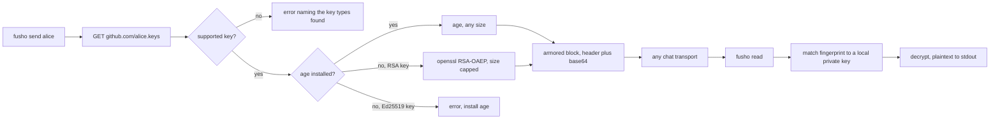

<div align="center">

<h1>fusho</h1>

<strong>Send an encrypted message through any chat, using a GitHub username as the address.</strong>

English | [日本語](README.ja.md) | [简体中文](README.zh-Hans.md) | [繁體中文 (香港)](README.zh-HK.md)

[](https://github.com/gufranco/fusho/actions/workflows/ci.yml)
[](https://github.com/gufranco/fusho/releases)
[](LICENSE)
[](#development)
[](#portability)

<p align="center">
  <a href="#quick-start"><strong>Quick start</strong></a> |
  <a href="#how-it-works">How it works</a> |
  <a href="#what-it-does-not-do"><strong>Security limits</strong></a> |
  <a href="#troubleshooting">Troubleshooting</a>
</p>

</div>

Five commands, 161 tests, one POSIX `sh` file, and no runtime dependency beyond `age`.

> [!NOTE]
> **Threat model.** fusho keeps a secret out of chat history: the retention policy, the backup nobody remembers configuring, the colleague who inherits the channel in 2031. It does not protect against a keylogger, a nation-state, or the coworker who pastes the plaintext right under the encrypted block "just in case". Those are covered in [what it does not do](#what-it-does-not-do), and mostly by a much larger budget.

`fusho` is 封書, Japanese for a sealed letter: addressed to one person, opened only by them.

---

```console
$ fusho send alice 'database password: correct-horse-battery-staple'
-----BEGIN FUSHO MESSAGE-----
v: 1
alg: age
to: alice
key: SHA256:iD5CQysP5Zu+ugBNVoQSDruYFlSFJSJiFQwUXbpdGh4

YWdlLWVuY3J5cHRpb24ub3JnL3YxCi0+IHNzaC1lZDI1NTE5IGlENUNReSBhWDNu
UjZQd2NCRWRhVGJZbUFVWjZHUUFEeUJIUGNZTFVoMkc5ZmVRR0ZzCg==
-----END FUSHO MESSAGE-----
fusho: copied to the clipboard with pbcopy.
```

Paste all of it into Slack, Telegram, a Jira ticket, or an email. Alice runs one command:

```console
$ pbpaste | fusho read
database password: correct-horse-battery-staple
```

Every GitHub account publishes its SSH public keys at `github.com/<user>.keys`. `fusho` encrypts to those keys, and the recipient decrypts with the private key already in their `~/.ssh`. There is no key exchange, keyserver, or account to create.

Above `BEGIN`, the block carries a short note telling a first-time recipient what it is and how to open it. The parser ignores everything above `BEGIN`, so the note can never corrupt a message. Turn it off with `--no-banner` or `FUSHO_BANNER=0`.

## Quick start

### Prerequisites

| Tool | Why | Install |
|:-----|:----|:--------|
| POSIX `sh` | The tool itself | Preinstalled everywhere. `bash` is not required |
| `curl`, `ssh-keygen`, `openssl` | Key fetch, fingerprints, base64 | Preinstalled on macOS and Linux |
| [`age`](https://github.com/FiloSottile/age) | The encryption engine | `brew install age` or `apt install age`. Installed automatically by the Homebrew formula |
| `qrencode` | Optional, only for `--qr` | `brew install qrencode` or `apt install qrencode` |

> [!IMPORTANT]
> Without `age`, fusho falls back to RSA through `openssl`. That path cannot encrypt to an Ed25519 key and caps a message at 470 bytes. Most GitHub accounts publish Ed25519 keys, so install `age`.

### Install

```bash
brew install gufranco/tap/fusho
```

The formula lives in [gufranco/homebrew-tap](https://github.com/gufranco/homebrew-tap). Or from source, which also installs the man page and shell completions:

```bash
git clone https://github.com/gufranco/fusho.git
cd fusho
make install
```

Every [release](https://github.com/gufranco/fusho/releases) also attaches a ready-to-run `dist/fusho`, so a recipient can download one file, read it, and run it.

### Verify

```console
$ fusho doctor
age            ok       v1.3.1
curl           ok
ssh-keygen     ok
openssl        ok       OpenSSL
identities     ok       1 usable key pair(s) under ~/.ssh
```

## Usage

| Command | Purpose |
|:--------|:--------|
| `fusho send <user>[@host] [message]` | Encrypt to a user on GitHub, GitLab, Codeberg, SourceHut, or a self-hosted forge. Reads stdin when no message is given |
| `fusho read [file]` | Decrypt. Reads stdin when piped, otherwise the clipboard |
| `fusho keys <user>` | List the keys fusho can encrypt to, with fingerprints |
| `fusho doctor` | Check the local environment and print a remedy for each failure |
| `fusho version` | Print the version and the active engine |

| Flag | Effect |
|:-----|:-------|
| `--to <target>` | Add a recipient. Repeat for several |
| `--sign <you>` | Sign as a user whose published key you hold |
| `--require-signature` | On read, refuse a message with no signature |
| `--accept-new-key` | Accept a recipient whose pinned keys changed |
| `--expires <when>` | Mark the message stale after `30m`, `6h`, `7d` and so on |
| `--ignore-expiry` | On read, open a message the sender marked as expired |
| `--key <prefix>` | Encrypt to one key only, chosen by fingerprint prefix |
| `--keys-file <path>` | Add recipients from a local public key file |
| `--identity <path>` | Decrypt with a specific private key |
| `--identity-command <cmd>` | Read the private key from a command, for keys kept in a secret manager |
| `--json` | Print machine-readable output |
| `--qr` | Print the message as a QR code |
| `--no-banner` | Omit the note above the block |
| `--no-clipboard` | Do not copy the result to the clipboard |

```bash
printf 'the secret' | fusho send alice          # stdin keeps it out of the process list
fusho send alice:iD5CQy 'only to that one key'  # pin one key by fingerprint prefix
fusho send bob@gitlab 'works across forges'     # gitlab, codeberg, sourcehut, self-hosted
fusho send --to alice --to bob@codeberg 'hi'    # one message, several people
fusho read                                      # with nothing piped, reads the clipboard
```

> [!TIP]
> Pipe the secret on stdin instead of passing it as an argument. Every user on the machine can see an argument in the process list.

### Key hosts

| Host | Recipient syntax | Status |
|:-----|:-----------------|:-------|
| GitHub | `alice` | Default |
| GitLab | `alice@gitlab` | Supported |
| Codeberg | `alice@codeberg` | Supported |
| SourceHut | `alice@sourcehut` | Supported |
| Self-hosted Gitea, Forgejo, GitLab | `alice@git.example.com` | Any host serving `/<user>.keys` |
| Bitbucket | Not supported | It publishes no public key endpoint; use `--keys-file` |

## How it works



| Engine | Recipient keys | Size limit | Integrity |
|:-------|:---------------|:-----------|:----------|
| `age`, used whenever installed | `ssh-ed25519` and `ssh-rsa` | None in practice | Authenticated encryption |
| `openssl` fallback | `ssh-rsa` only | 470 bytes at 4096-bit, 214 at 2048-bit | Confidentiality only, no integrity check |

The fallback lets a recipient who cannot install anything still receive a short secret, and `fusho send` warns on stderr when it is used. It refuses an Ed25519 recipient and an oversized message instead of emitting something broken. fusho implements no cryptography of its own; it delegates to `age` or `openssl`.

### Signing

An unsigned message is confidential but anonymous. `--sign` closes that gap with the SSH key the sender already publishes:

```console
$ fusho send alice --sign you 'this really is from me'

$ fusho read message.txt
fusho: signature verified against a key published by 'you'.
this really is from me
```

The signature covers the ciphertext and is checked with `ssh-keygen -Y verify` against the claimed sender's published keys. A tampered body, or a `from:` swapped to someone else, fails and prints no plaintext.

### Key pinning

The first message to someone records their fingerprints in `${XDG_CONFIG_HOME:-~/.config}/fusho/known_recipients`. If those keys change later, the send stops:

```console
$ fusho send alice 'secret'
fusho: the keys published by alice changed since you last messaged them.
  pinned:  SHA256:Hb2u7V4cmzORXDF0QulbVVq83T/B6AfX+64LPZS64n0
  current: SHA256:6FV5K276oVndQJv5uxtytvD/KIrimmU/SmWvEgmmdIo
  a key rotation looks exactly like an account takeover from here.
  verify the fingerprint with them out of band, then re-run with --accept-new-key
```

## What it does not do

> [!WARNING]
> **An unsigned message proves nothing about who sent it.** Anyone can encrypt to a public key and claim to be anyone. Sign with `--sign <you>`, or refuse unsigned messages with `--require-signature`.

| Limit | Detail |
|:------|:-------|
| Unauthenticated header | The `to:` and `key:` lines are routing metadata. Altering them causes an identity error, never a wrong plaintext, because `age` authenticates the body |
| Readable by every key on the account | The recipient can read on any device, so the message is only as safe as their weakest published key. Pin one with `--key` |
| The forge is the trust anchor | Someone who adds a key to the recipient's account can read messages sent afterwards. Key pinning turns that silent takeover into a refused send |

## Troubleshooting

<details>
<summary><strong>decryption failed, and my private key starts with BEGIN OPENSSH PRIVATE KEY</strong></summary>
<br>

Only the `openssl` fallback needs a PEM key. Convert it, keeping the same public key:

```bash
ssh-keygen -p -m PEM -f ~/.ssh/id_rsa
```

</details>

<details>
<summary><strong>no local private key matches this message</strong></summary>
<br>

The message was addressed to a key whose private half is not on this machine. fusho prints the fingerprint it wanted; compare it with yours:

```bash
ssh-keygen -lf ~/.ssh/*.pub
```

</details>

<details>
<summary><strong>My keys live in 1Password, Secretive, or another SSH agent</strong></summary>
<br>

`age` decrypts only with a key file, and an agent never hands over the private half. Supply the key from your secret manager instead; fusho writes it to a private temporary file and removes it on exit:

```bash
pbpaste | fusho read --identity-command "op read 'op://Private/ssh-key/private key'"
```

</details>

<details>
<summary><strong>publishes no key fusho can encrypt to</strong></summary>
<br>

The account has only ECDSA keys, which neither engine supports. Ask the recipient for an Ed25519 or RSA key.

</details>

<details>
<summary><strong>I have no key pair yet</strong></summary>
<br>

Create one and add the public half at [github.com/settings/keys](https://github.com/settings/keys):

```bash
ssh-keygen -t ed25519 -f ~/.ssh/id_ed25519
```

</details>

<details>
<summary><strong>I used fusho when it was called osm</strong></summary>
<br>

Messages that begin with `BEGIN OSM MESSAGE` still open, signatures made under the old name still verify, and `~/.config/osm` moves to `~/.config/fusho` the first time you run it. Environment variables now use the `FUSHO_` prefix.

</details>

## More options

| Behaviour | Detail |
|:----------|:-------|
| Compression | Payloads are gzipped when that makes them smaller, marked with an `enc:` header. A 4000-byte repetitive payload becomes a 495-byte message |
| Weak key warning | A recipient key under 3072-bit RSA is flagged on every send. Change the floor with `FUSHO_MIN_RSA_BITS` |
| Clipboard expiry | The copied message is cleared after 90 seconds, only if the clipboard still holds it. `FUSHO_CLIPBOARD_TIMEOUT=0` disables it |
| Custom clipboard | `FUSHO_CLIPBOARD_COPY` and `FUSHO_CLIPBOARD_PASTE` take any command, for tmux or SSH sessions |
| Message expiry | `--expires 6h` records a deadline that `fusho read` enforces. It is advisory: a message someone can decrypt cannot be un-sent |
| QR output | `--qr` renders the message for phone-to-laptop transfer, when `qrencode` is installed |

## Portability

The shipped artifact is POSIX `sh`. Each row below passed a full encrypt-and-decrypt round trip.

| Shell | Status |
|:------|:-------|
| `dash`, `busybox ash`, `posh` | Supported |
| `bash` 3.2 and 5.x, `zsh`, `mksh` | Supported |
| `ksh93` | Not supported. It lacks `local`, so fusho exits with a message naming the problem |

| System | Status |
|:-------|:-------|
| macOS | Tahoe on Apple Silicon and Intel, including stock `/bin/sh` and LibreSSL |
| Linux, glibc | Debian and Ubuntu |
| Linux, musl | Alpine with `bash` removed |
| FreeBSD, OpenBSD, NetBSD | Not covered by CI. Their `/bin/sh` supports every construct the artifact uses |

## Development

| Command | Description |
|:--------|:------------|
| `make check` | Format, lint, test, and the coverage gate |
| `make build` | Concatenate [`lib/`](lib) into `dist/fusho` |
| `make test` | The 161 `bats` tests |
| `make cover` | `kcov`, gated at 91% |
| `make install` | Copy the artifact, man page and completions into place |

The 10 modules in [`lib/`](lib) are concatenated by [`build.sh`](build.sh) into one 1147-line file, so what people install can be read in one pass. Tests run against real `age` and `openssl` with generated keys, and [`test/helpers/keyserver.py`](test/helpers/keyserver.py) serves the key endpoint locally, so `curl` sees real HTTP status codes.

kcov cannot follow background subshells, `PATH`-sandboxed children, or binary streams, so the clipboard readers and some engine-failure paths are tested without being counted. The gate is set to what kcov can observe.

| Convention | Source |
|:-----------|:-------|
| Commit format | [Conventional Commits](https://www.conventionalcommits.org/) |
| Shell linting | [`.shellcheckrc`](.shellcheckrc), `enable=all` at zero warnings |
| Formatting | `shfmt -i 2` |
| Bash floor | 3.2, so macOS `/bin/bash` is a supported target |

CI runs the suite on Ubuntu and on macOS Tahoe for Apple Silicon and Intel, again under macOS system Bash 3.2, across every POSIX shell in a container, and on Alpine with `bash` uninstalled. It also encrypts on a macOS runner and decrypts on a Linux runner, comparing checksums.

## Versioning

fusho follows [Semantic Versioning](https://semver.org/). Every release is tagged and published on the [releases page](https://github.com/gufranco/fusho/releases) with its changelog.

## Alternatives

[`ssh-vault`](https://github.com/ssh-vault/ssh-vault) solves the same problem as a compiled binary, if you would rather not run a shell script. There is also an [open request](https://github.com/cli/cli/issues/12202) to build this into `gh`.

## License

[MIT](LICENSE)
