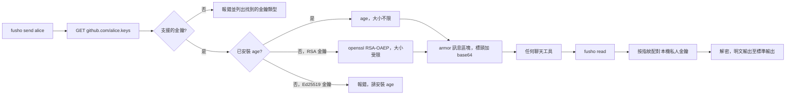

<div align="center">

<h1>fusho</h1>

<strong>以 GitHub 用戶名稱作收件地址，經任何聊天工具傳送加密訊息。</strong>

[English](README.md) | [日本語](README.ja.md) | [简体中文](README.zh-Hans.md) | 繁體中文 (香港)

[](https://github.com/gufranco/fusho/actions/workflows/ci.yml)
[](https://github.com/gufranco/fusho/releases/latest)
[](LICENSE)

<p align="center">
  <a href="#quick-start"><strong>快速開始</strong></a> |
  <a href="#how-it-works">運作原理</a> |
  <a href="#what-it-does-not-do"><strong>保安限制</strong></a> |
  <a href="#troubleshooting">疑難排解</a>
</p>

</div>

五個指令，211 個測試，11 個 POSIX `sh` 模組，執行時只需要 `age`。

> [!NOTE]
> **威脅模型。** fusho 令秘密不會留在聊天記錄之中：保留政策、沒有人記得設定過的備份、2031 年接手這個頻道的同事，都看不到它。它防不了鍵盤記錄程式、國家級對手，也防不了那位為求穩妥、把明文貼在加密區塊正下方的同事。這些情況寫在[它做不到的事](#what-it-does-not-do)之中，而且大多需要大得多的預算。

`fusho` 來自日文的封書一詞，意思是封好的信：寫給一個人，只有那個人能夠拆開。

---

```console
$ fusho send --no-banner alice 'database password: correct-horse-battery-staple'
-----BEGIN FUSHO MESSAGE-----
v: 1
alg: age
to: alice
key: SHA256:iD5CQysP5Zu+ugBNVoQSDruYFlSFJSJiFQwUXbpdGh4

YWdlLWVuY3J5cHRpb24ub3JnL3YxCi0+IHNzaC1lZDI1NTE5IGlENUNReSBhWDNu
UjZQd2NCRWRhVGJZbUFVWjZHUUFEeUJIUGNZTFVoMkc5ZmVRR0ZzCg==
-----END FUSHO MESSAGE-----
fusho: copied to the clipboard with pbcopy.
```

將全部內容貼到 Slack、Telegram、Jira 工作項目或電郵。Alice 只需執行一個指令：

```console
$ pbpaste | fusho read
database password: correct-horse-battery-staple
```

每個 GitHub 帳戶都會在 `github.com/<user>.keys` 公開其 SSH 公開金鑰。`fusho` 以這些金鑰加密，收件人用自己 `~/.ssh` 內的私人金鑰解密。毋須交換金鑰，毋須金鑰伺服器，也毋須開設帳戶。

在 `BEGIN` 上方，訊息區塊附有一段簡短說明，告訴第一次收到的人這是甚麼、怎樣打開。解析器會略過 `BEGIN` 上方的所有內容，所以這段說明不會損壞訊息。可以用 `--no-banner` 或 `FUSHO_BANNER=0` 關閉。

<a id="quick-start"></a>

## 快速開始

### 先決條件

| 工具 | 用途 | 安裝 |
|:-----|:----|:--------|
| POSIX `sh` | 工具本身 | 各系統均已預載。毋須 `bash` |
| `curl`、`ssh-keygen`、`openssl` | 取得金鑰、指紋、base64 | macOS 和 Linux 已預載 |
| [`age`](https://github.com/FiloSottile/age) | 加密引擎 | `brew install age` 或 `apt install age`。Homebrew formula 會自動安裝 |
| `qrencode` | 選用，只供 `--qr` 使用 | `brew install qrencode` 或 `apt install qrencode` |

> [!IMPORTANT]
> 沒有 `age` 時，fusho 會改用 `openssl` 的 RSA。這個方式無法加密至 Ed25519 金鑰，訊息上限為 470 位元組。大部分 GitHub 帳戶公開的是 Ed25519 金鑰，所以請安裝 `age`。

### 安裝

```bash
brew install gufranco/tap/fusho
```

formula 位於 [gufranco/homebrew-tap](https://github.com/gufranco/homebrew-tap)。亦可從原始碼安裝，這樣還會裝上 man 說明頁和 shell 自動補全：

```bash
git clone https://github.com/gufranco/fusho.git
cd fusho
make install
```

### 驗證

```console
$ fusho doctor
age                ok       /opt/homebrew/bin/age, v1.3.2
curl               ok       /usr/bin/curl
ssh-keygen         ok       /usr/bin/ssh-keygen
awk                ok       /usr/bin/awk, bsd 20200816
sed                ok       /usr/bin/sed, bsd
tr                 ok       /usr/bin/tr, bsd
date               ok       /bin/date, bsd
openssl            ok       /usr/bin/openssl, LibreSSL. the RSA fallback pins OAEP to SHA-1 so it interoperates with OpenSSL
identities         ok       2 usable key pair(s) under ~/.ssh
```

## 用法

| 指令 | 用途 |
|:--------|:--------|
| `fusho` | 喺終端機會先問你想做咩，再逐個問需要嘅值。`send`、`read` 同 `keys` 都會問缺少嘅值 |
| `fusho send <user>[@host] [message]` | 加密給 GitHub、GitLab、Codeberg、SourceHut 或自行架設的程式碼託管平台上的用戶。未提供訊息時讀取標準輸入 |
| `fusho read [file]` | 解密。有管道輸入時讀取標準輸入，否則讀取剪貼簿 |
| `fusho keys <user>` | 列出 fusho 可以加密至的金鑰及其指紋 |
| `fusho doctor` | 檢查本機環境，並為每個失敗項目提供解決方法 |
| `fusho version`、`fusho help` | 顯示版本和正在使用的引擎，或完整用法 |

| 選項 | 作用 |
|:-----|:-------|
| `--to <target>` | 加入收件人。多人時重複使用 |
| `--sign <you>` | 以你持有其私人金鑰的用戶身分簽署 |
| `--require-signature` | 讀取時拒絕沒有簽署的訊息 |
| `--accept-new-key` | 接受已釘選金鑰有變的收件人 |
| `--expires <when>` | 在 `30m`、`6h`、`7d` 等時間後將訊息標示為過期 |
| `--ignore-expiry` | 讀取時打開寄件人標示為過期的訊息 |
| `--key <prefix>` | 只加密至按指紋前綴選出的一個金鑰 |
| `--keys-file <path>` | 從本機公開金鑰檔案加入收件人 |
| `--identity <path>` | 使用指定的私人金鑰解密 |
| `--identity-command <cmd>` | 從指令讀取私人金鑰，適用於存放在密碼管理工具中的金鑰 |
| `--json` | 輸出機器可讀的格式 |
| `--qr` | 以 QR 碼輸出訊息 |
| `--no-banner` | 省略訊息區塊上方的說明 |
| `--no-clipboard` | 不將結果複製到剪貼簿 |

```bash
printf 'the secret' | fusho send alice          # stdin keeps it out of the process list
fusho send alice:iD5CQy 'only to that one key'  # pin one key by fingerprint prefix
fusho send bob@gitlab 'works across forges'     # gitlab, codeberg, sourcehut, self-hosted
fusho send --to alice --to bob@codeberg 'hi'    # one message, several people
fusho read                                      # with nothing piped, reads the clipboard
```

也可以寫成 `--to=alice`，`--` 表示選項結束。fusho 遵循同系列工具共用的命令列約定，詳見 [FAMILY.md](FAMILY.md)。

> [!TIP]
> 請經標準輸入傳入秘密，不要作為參數。電腦上的每位用戶都能在程序列表中看到參數。

### 金鑰託管平台

| 平台 | 收件人寫法 | 狀態 |
|:-----|:-----------------|:-------|
| GitHub | `alice` | 預設 |
| GitLab | `alice@gitlab` | 支援 |
| Codeberg | `alice@codeberg` | 支援 |
| SourceHut | `alice@sourcehut` | 支援 |
| 自行架設的 Gitea、Forgejo、GitLab | `alice@git.example.com` | 任何提供 `/<user>.keys` 的平台 |
| Bitbucket | 不支援 | 它沒有公開的金鑰端點，請使用 `--keys-file` |

<a id="how-it-works"></a>

## 運作原理



| 引擎 | 收件人金鑰 | 大小上限 | 完整性 |
|:-------|:---------------|:-----------|:----------|
| `age`，只要已安裝便會使用 | `ssh-ed25519` 和 `ssh-rsa` | 實際上沒有 | 已驗證加密 |
| `openssl` 後備方案 | 只限 `ssh-rsa` | 4096 位元時 470 位元組，2048 位元時 214 位元組 | 只保密，沒有完整性檢查 |

有了後備方案，無法安裝任何軟件的收件人也能收到簡短的秘密；使用時，`fusho send` 會在標準錯誤輸出警告。它會拒絕 Ed25519 收件人和過大的訊息，而不會輸出損壞的內容。fusho 不會自行實作任何密碼學，全部交由 `age` 或 `openssl` 處理。

### 簽署

未簽署的訊息是保密的，但無法得知寄件人。`--sign` 用寄件人已公開的 SSH 金鑰填補這個缺口：

```console
$ fusho send alice --sign you 'this really is from me'

$ fusho read message.txt
fusho: signature verified against a key published by 'you'.
this really is from me
```

簽署涵蓋密文，並以 `ssh-keygen -Y verify` 對照聲稱的寄件人所公開的金鑰作驗證。內文被竄改，或 `from:` 被換成他人，都會驗證失敗，而且不會輸出明文。

### 金鑰釘選

第一次傳訊息給某人時，fusho 會把對方的指紋記錄在 `${XDG_CONFIG_HOME:-~/.config}/fusho/known_recipients`。之後如果這些金鑰有變，傳送便會停止：

```console
$ fusho send alice 'secret'
fusho: the keys published by alice changed since you last messaged them.
  pinned:  SHA256:Hb2u7V4cmzORXDF0QulbVVq83T/B6AfX+64LPZS64n0
  current: SHA256:6FV5K276oVndQJv5uxtytvD/KIrimmU/SmWvEgmmdIo
  a key rotation looks exactly like an account takeover from here.
  check the fingerprint with them out of band, then re-run with --accept-new-key
```

<a id="what-it-does-not-do"></a>

## 它做不到的事

> [!WARNING]
> **未簽署的訊息無法證明是誰傳送的。** 任何人都能加密至一個公開金鑰，並冒認任何人。請用 `--sign <you>` 簽署，或用 `--require-signature` 拒絕未簽署的訊息。

| 限制 | 詳情 |
|:------|:-------|
| 未經驗證的標頭 | `to:` 和 `key:` 兩行是路由資料。修改它們會引致身分錯誤，但不會得出錯誤的明文，因為 `age` 已驗證內文 |
| 帳戶的每個金鑰都能讀取 | 收件人在任何裝置上都能讀取，所以訊息的安全程度取決於其最弱的公開金鑰。可以用 `--key` 釘選一個 |
| 信任來源是程式碼託管平台 | 能夠在收件人帳戶加入金鑰的人，可以讀取之後傳送的訊息。金鑰釘選會把這種無聲的接管變成被拒絕的傳送 |

<a id="troubleshooting"></a>

## 疑難排解

<details>
<summary><strong>出現 decryption failed，而我的私人金鑰以 BEGIN OPENSSH PRIVATE KEY 開頭</strong></summary>
<br>

只有 `openssl` 後備方案需要 PEM 格式的金鑰。在保留同一公開金鑰的情況下轉換：

```bash
ssh-keygen -p -m PEM -f ~/.ssh/id_rsa
```

</details>

<details>
<summary><strong>出現 no local private key matches this message</strong></summary>
<br>

這則訊息加密至的金鑰，其私人金鑰不在這部電腦上。fusho 會顯示它需要的指紋，請與你自己的比對：

```bash
ssh-keygen -lf ~/.ssh/*.pub
```

</details>

<details>
<summary><strong>我的金鑰存放在 1Password、Secretive 或其他 SSH agent</strong></summary>
<br>

`age` 只能用金鑰檔案解密，而 agent 不會交出私人金鑰。請改為從密碼管理工具提供金鑰；fusho 會把它寫入一個私人的臨時檔案，並在結束時刪除：

```bash
pbpaste | fusho read --identity-command "op read 'op://Private/ssh-key/private key'"
```

</details>

<details>
<summary><strong>出現 publishes no key fusho can encrypt to</strong></summary>
<br>

該帳戶只有 ECDSA 金鑰，兩個引擎都不支援。請要求收件人提供 Ed25519 或 RSA 金鑰。

</details>

<details>
<summary><strong>我還未有金鑰對</strong></summary>
<br>

建立一對金鑰，並把公開金鑰加到 [github.com/settings/keys](https://github.com/settings/keys)：

```bash
ssh-keygen -t ed25519 -f ~/.ssh/id_ed25519
```

</details>

<details>
<summary><strong>我用過它叫 osm 時的版本</strong></summary>
<br>

以 `BEGIN OSM MESSAGE` 開頭的訊息仍然可以打開，以舊名稱建立的簽署仍然可以驗證，`~/.config/osm` 會在第一次執行時移至 `~/.config/fusho`。環境變數現時使用 `FUSHO_` 前綴。

</details>

## 更多選項

| 行為 | 詳情 |
|:----------|:-------|
| 壓縮 | 如果可以變小，內容會用 gzip 壓縮，並以 `enc:` 標頭標示。一個重複度高的 4000 位元組內容會變成 495 位元組的訊息 |
| 弱金鑰警告 | 收件人的 RSA 金鑰低於 3072 位元時，每次傳送都會提示。可以用 `FUSHO_MIN_RSA_BITS` 更改下限 |
| 剪貼簿到期 | 複製的訊息會在 90 秒後清除，前提是剪貼簿仍然是它。`FUSHO_CLIPBOARD_TIMEOUT=0` 可以停用 |
| 自訂剪貼簿 | `FUSHO_CLIPBOARD_COPY` 和 `FUSHO_CLIPBOARD_PASTE` 可以設定任何指令，適用於 tmux 或 SSH 工作階段 |
| 訊息到期 | `--expires 6h` 會記錄限期，由 `fusho read` 執行。它只屬提示：能夠解密的訊息無法收回 |
| QR 碼輸出 | 安裝了 `qrencode` 時，`--qr` 會顯示訊息，方便由手機傳到電腦 |

## 版本管理

fusho 遵循[語意化版本](https://semver.org/)。每個版本都有標籤，並連同變更記錄發佈在[版本頁面](https://github.com/gufranco/fusho/releases)。

## 替代方案

[`ssh-vault`](https://github.com/ssh-vault/ssh-vault) 以已編譯的程式解決同一問題，適合不想執行 shell 指令碼的人。另外亦有一個把這項功能加入 `gh` 的[公開要求](https://github.com/cli/cli/issues/12202)。

<a id="portability"></a>

## 可攜性

fusho 是 POSIX `sh`。下表每一行都通過了完整的加密及解密往返測試。

| Shell | 狀態 |
|:------|:-------|
| `dash`、`busybox ash`、`posh` | 支援 |
| `bash` 3.2 和 5.x、系統內置和 Homebrew 的 `zsh`、`mksh` | 支援 |
| `ksh93` | 不支援。它沒有 `local`，fusho 會顯示說明問題的訊息後結束 |

| 系統 | 狀態 |
|:-------|:-------|
| macOS | Apple Silicon 和 Intel 上的 Tahoe，既用內置的 `/bin/sh`、LibreSSL、curl 和 OpenSSH，亦用 Homebrew 的 openssl@3、curl、OpenSSH 和 gzip |
| Linux，glibc | Debian 和 Ubuntu |
| Linux，musl | 移除了 `bash` 的 Alpine |
| FreeBSD、OpenBSD、NetBSD | 不在 CI 範圍內。它們的 `/bin/sh` 支援 fusho 用到的所有語法 |

它能在五種常用工具集上執行：Linux 上的 GNU 或 uutils coreutils，以及 macOS 內置的工具、Homebrew 中較新的版本或 Homebrew 的 uutils 工具。macOS 內置而 Homebrew 有較新版本的工具，由 bash 和 zsh 到 openssl、curl、ssh-keygen 和 gzip，兩個版本都會測試。CI 在每種工具集上執行全部測試，`fusho doctor` 會列出每個核心工具的類型和版本，例如 `gnu 9.7`、`uutils 0.12.0` 或 `bsd 20200816`，讓錯誤報告說明用的是哪些工具。

<a id="development"></a>

## 開發

| 指令 | 說明 |
|:--------|:------------|
| `make check` | lint 及測試 |
| `make test` | 211 個 `bats` 測試 |
| `make coverage` | bashcov 行覆蓋率，門檻為 100% |
| `make install` | 把主程式、man 說明頁及自動補全安裝到 `PREFIX` 之下，預設為 `~/.local` |

[`bin/fusho`](bin/fusho) 載入 [`lib/`](lib) 內的 11 個模組；沒有建置步驟，安裝的就是這個儲存庫內的程式碼。測試以產生的金鑰執行真實的 `age` 和 `openssl`，[`test/helpers/keyserver.py`](test/helpers/keyserver.py) 在本機提供金鑰端點，所以 `curl` 看到的是真實的 HTTP 狀態碼。


| 慣例 | 來源 |
|:-----------|:-------|
| 提交格式 | [Conventional Commits](https://www.conventionalcommits.org/) |
| Shell lint | [`.shellcheckrc`](.shellcheckrc)，`enable=all` 而且零警告 |
| 格式 | `shfmt -i 2` |
| Bash 最低版本 | 3.2，以支援 macOS 的 `/bin/bash` |

CI 在 Ubuntu 以及 Apple Silicon 和 Intel 的 macOS Tahoe 上執行測試，並在 macOS 內置的 Bash 3.2、容器內的所有 POSIX shell，以及移除了 `bash` 的 Alpine 上再次執行。它亦會在 macOS 執行器上加密、在 Linux 執行器上解密，並比對校驗碼。

## 授權

[MIT](LICENSE)
