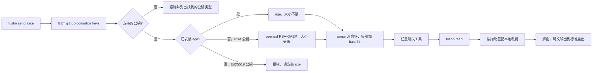

<div align="center">

<h1>fusho</h1>

<strong>以 GitHub 用户名为收件地址，通过任意聊天工具发送加密消息。</strong>

[English](README.md) | [日本語](README.ja.md) | 简体中文 | [繁體中文 (香港)](README.zh-HK.md)

[](https://github.com/gufranco/fusho/actions/workflows/ci.yml)
[](https://github.com/gufranco/fusho/releases)
[](LICENSE)
[](#development)
[](#portability)

<p align="center">
  <a href="#quick-start"><strong>快速开始</strong></a> |
  <a href="#how-it-works">工作原理</a> |
  <a href="#what-it-does-not-do"><strong>安全限制</strong></a> |
  <a href="#troubleshooting">故障排除</a>
</p>

</div>

五个命令，204 个测试，一个 POSIX `sh` 文件，运行时只依赖 `age`。

> [!NOTE]
> **威胁模型。** fusho 让秘密不留在聊天记录里：保留策略、没人记得配置过的备份、2031 年接手这个频道的同事，都看不到它。它防不了键盘记录器、国家级对手，也防不了那位为了以防万一、把明文贴在加密块正下方的同事。这些情况写在[它做不到的事](#what-it-does-not-do)里，而且大多需要大得多的预算。

`fusho` 来自日语的封書一词，意为封好的信：写给一个人，只有那个人能拆开。

---

```console
$ fusho send --no-banner alice 'database password: correct-horse-battery-staple'
-----BEGIN FUSHO MESSAGE-----
v: 1
alg: age
to: alice
key: SHA256:iD5CQysP5Zu+ugBNVoQSDruYFlSFJSJiFQwUXbpdGh4

YWdlLWVuY3J5cHRpb24ub3JnL3YxCi0+IHNzaC1lZDI1NTE5IGlENUNReSBhWDNu
UjZQd2NCRWRhVGJZbUFVWjZHUUFEeUJIUGNZTFVoMkc5ZmVRR0ZzCg==
-----END FUSHO MESSAGE-----
fusho: copied to the clipboard with pbcopy.
```

把全部内容粘贴到 Slack、Telegram、Jira 工单或邮件里。Alice 只需运行一条命令：

```console
$ pbpaste | fusho read
database password: correct-horse-battery-staple
```

每个 GitHub 账号都会在 `github.com/<user>.keys` 公开自己的 SSH 公钥。`fusho` 用这些公钥加密，收件人用自己 `~/.ssh` 里的私钥解密。不需要交换密钥，不需要密钥服务器，也不需要注册账号。

在 `BEGIN` 上方，消息块附带一段简短说明，告诉第一次收到的人这是什么、如何打开。解析器会忽略 `BEGIN` 上方的所有内容，所以这段说明不会破坏消息。可以用 `--no-banner` 或 `FUSHO_BANNER=0` 关闭它。

<a id="quick-start"></a>

## 快速开始

### 前提条件

| 工具 | 用途 | 安装 |
|:-----|:----|:--------|
| POSIX `sh` | 工具本身 | 各系统均已预装。不需要 `bash` |
| `curl`、`ssh-keygen`、`openssl` | 获取公钥、指纹、base64 | macOS 和 Linux 已预装 |
| [`age`](https://github.com/FiloSottile/age) | 加密引擎 | `brew install age` 或 `apt install age`。Homebrew formula 会自动安装 |
| `qrencode` | 可选，仅用于 `--qr` | `brew install qrencode` 或 `apt install qrencode` |

> [!IMPORTANT]
> 没有 `age` 时，fusho 会改用 `openssl` 的 RSA。这种方式无法加密到 Ed25519 公钥，消息上限为 470 字节。大多数 GitHub 账号公开的是 Ed25519 公钥，所以请安装 `age`。

### 安装

```bash
brew install gufranco/tap/fusho
```

formula 位于 [gufranco/homebrew-tap](https://github.com/gufranco/homebrew-tap)。也可以从源码安装，这样还会装上 man 手册和 shell 补全：

```bash
git clone https://github.com/gufranco/fusho.git
cd fusho
make install
```

每个[版本](https://github.com/gufranco/fusho/releases)都附带可直接运行的 `dist/fusho`，收件人可以只下载这一个文件，读完再运行。

### 验证

```console
$ fusho doctor
age                ok       /opt/homebrew/bin/age, v1.3.2
curl               ok       /usr/bin/curl
ssh-keygen         ok       /usr/bin/ssh-keygen
awk                ok       /usr/bin/awk, bsd 20200816
sed                ok       /usr/bin/sed, bsd
tr                 ok       /usr/bin/tr, bsd
date               ok       /bin/date, bsd
openssl            ok       /usr/bin/openssl, LibreSSL. the RSA fallback pins OAEP to SHA-1 so it interoperates with OpenSSL
identities         ok       2 usable key pair(s) under ~/.ssh
```

## 用法

| 命令 | 用途 |
|:--------|:--------|
| `fusho` | 在终端中先询问要做什么，再依次询问每个值。`send`、`read` 和 `keys` 也会询问缺少的值 |
| `fusho send <user>[@host] [message]` | 加密给 GitHub、GitLab、Codeberg、SourceHut 或自建代码托管平台上的用户。未给出消息时读取标准输入 |
| `fusho read [file]` | 解密。有管道输入时读取标准输入，否则读取剪贴板 |
| `fusho keys <user>` | 列出 fusho 可以加密到的公钥及其指纹 |
| `fusho doctor` | 检查本地环境，并为每个失败项给出解决办法 |
| `fusho version`、`fusho help` | 显示版本和当前使用的引擎，或完整用法 |

| 选项 | 作用 |
|:-----|:-------|
| `--to <target>` | 添加收件人。多人时重复使用 |
| `--sign <you>` | 以你持有其私钥的用户身份签名 |
| `--require-signature` | 读取时拒绝没有签名的消息 |
| `--accept-new-key` | 接受固定公钥已变化的收件人 |
| `--expires <when>` | 在 `30m`、`6h`、`7d` 等时间后将消息标记为过期 |
| `--ignore-expiry` | 读取时打开发件人标记为过期的消息 |
| `--key <prefix>` | 只加密到按指纹前缀选出的一个公钥 |
| `--keys-file <path>` | 从本地公钥文件添加收件人 |
| `--identity <path>` | 使用指定的私钥解密 |
| `--identity-command <cmd>` | 从命令读取私钥，适用于存放在密钥管理器中的私钥 |
| `--json` | 输出机器可读的格式 |
| `--qr` | 以二维码输出消息 |
| `--no-banner` | 省略消息块上方的说明 |
| `--no-clipboard` | 不把结果复制到剪贴板 |

```bash
printf 'the secret' | fusho send alice          # stdin keeps it out of the process list
fusho send alice:iD5CQy 'only to that one key'  # pin one key by fingerprint prefix
fusho send bob@gitlab 'works across forges'     # gitlab, codeberg, sourcehut, self-hosted
fusho send --to alice --to bob@codeberg 'hi'    # one message, several people
fusho read                                      # with nothing piped, reads the clipboard
```

也可以写成 `--to=alice`，`--` 表示选项结束。fusho 遵循同系列工具共用的命令行约定，详见 [FAMILY.md](FAMILY.md)。

> [!TIP]
> 请通过标准输入传入秘密，而不是作为参数。机器上的每个用户都能在进程列表中看到参数。

### 公钥托管平台

| 平台 | 收件人写法 | 状态 |
|:-----|:-----------------|:-------|
| GitHub | `alice` | 默认 |
| GitLab | `alice@gitlab` | 支持 |
| Codeberg | `alice@codeberg` | 支持 |
| SourceHut | `alice@sourcehut` | 支持 |
| 自建的 Gitea、Forgejo、GitLab | `alice@git.example.com` | 任何提供 `/<user>.keys` 的平台 |
| Bitbucket | 不支持 | 它没有公开的公钥接口，请使用 `--keys-file` |

<a id="how-it-works"></a>

## 工作原理



| 引擎 | 收件人公钥 | 大小上限 | 完整性 |
|:-------|:---------------|:-----------|:----------|
| `age`，只要已安装就使用 | `ssh-ed25519` 和 `ssh-rsa` | 实际上没有 | 认证加密 |
| `openssl` 备用方案 | 仅 `ssh-rsa` | 4096 位时 470 字节，2048 位时 214 字节 | 仅保密，无完整性校验 |

有了备用方案，无法安装任何软件的收件人也能收到简短的秘密；使用它时，`fusho send` 会在标准错误中给出警告。它会拒绝 Ed25519 收件人和过大的消息，而不是输出损坏的内容。fusho 不自行实现任何密码学，全部交给 `age` 或 `openssl`。

### 签名

未签名的消息是保密的，但无法得知发件人。`--sign` 用发件人已经公开的 SSH 公钥补上这个缺口：

```console
$ fusho send alice --sign you 'this really is from me'

$ fusho read message.txt
fusho: signature verified against a key published by 'you'.
this really is from me
```

签名覆盖密文，并用 `ssh-keygen -Y verify` 对照声称的发件人所公开的公钥进行验证。正文被篡改，或 `from:` 被换成别人，都会验证失败，并且不会输出明文。

### 公钥固定

第一次给某人发消息时，fusho 会把对方的指纹记录在 `${XDG_CONFIG_HOME:-~/.config}/fusho/known_recipients`。之后如果这些公钥变了，发送就会停止：

```console
$ fusho send alice 'secret'
fusho: the keys published by alice changed since you last messaged them.
  pinned:  SHA256:Hb2u7V4cmzORXDF0QulbVVq83T/B6AfX+64LPZS64n0
  current: SHA256:6FV5K276oVndQJv5uxtytvD/KIrimmU/SmWvEgmmdIo
  a key rotation looks exactly like an account takeover from here.
  verify the fingerprint with them out of band, then re-run with --accept-new-key
```

<a id="what-it-does-not-do"></a>

## 它做不到的事

> [!WARNING]
> **未签名的消息无法证明是谁发送的。** 任何人都能加密到一个公钥，并冒充任何人。请用 `--sign <you>` 签名，或用 `--require-signature` 拒绝未签名的消息。

| 限制 | 说明 |
|:------|:-------|
| 未经认证的头部 | `to:` 和 `key:` 行是路由信息。修改它们会导致身份错误，但不会得到错误的明文，因为 `age` 认证了正文 |
| 账号下的每个公钥都能读取 | 收件人在任何设备上都能读取，所以消息的安全性取决于其最弱的公开公钥。可以用 `--key` 固定一个 |
| 信任的根源是代码托管平台 | 能向收件人账号添加公钥的人，可以读取此后发送的消息。公钥固定会把这种悄无声息的接管变成被拒绝的发送 |

<a id="troubleshooting"></a>

## 故障排除

<details>
<summary><strong>出现 decryption failed，而我的私钥以 BEGIN OPENSSH PRIVATE KEY 开头</strong></summary>
<br>

只有 `openssl` 备用方案需要 PEM 格式的私钥。在保留同一公钥的前提下转换：

```bash
ssh-keygen -p -m PEM -f ~/.ssh/id_rsa
```

</details>

<details>
<summary><strong>出现 no local private key matches this message</strong></summary>
<br>

这条消息加密给的公钥，其私钥不在这台机器上。fusho 会显示它需要的指纹，请与你自己的比对：

```bash
ssh-keygen -lf ~/.ssh/*.pub
```

</details>

<details>
<summary><strong>我的私钥存放在 1Password、Secretive 或其他 SSH agent 中</strong></summary>
<br>

`age` 只能用私钥文件解密，而 agent 不会交出私钥。请改为从密钥管理器提供私钥；fusho 会把它写入一个私有的临时文件，并在退出时删除：

```bash
pbpaste | fusho read --identity-command "op read 'op://Private/ssh-key/private key'"
```

</details>

<details>
<summary><strong>出现 publishes no key fusho can encrypt to</strong></summary>
<br>

该账号只有 ECDSA 公钥，两个引擎都不支持。请让收件人提供 Ed25519 或 RSA 公钥。

</details>

<details>
<summary><strong>我还没有密钥对</strong></summary>
<br>

创建一对密钥，并把公钥添加到 [github.com/settings/keys](https://github.com/settings/keys)：

```bash
ssh-keygen -t ed25519 -f ~/.ssh/id_ed25519
```

</details>

<details>
<summary><strong>我用过它叫 osm 时的版本</strong></summary>
<br>

以 `BEGIN OSM MESSAGE` 开头的消息仍然可以打开，用旧名称生成的签名仍然可以验证，`~/.config/osm` 会在第一次运行时移到 `~/.config/fusho`。环境变量现在使用 `FUSHO_` 前缀。

</details>

## 更多选项

| 行为 | 说明 |
|:----------|:-------|
| 压缩 | 如果能变小，载荷会用 gzip 压缩，并用 `enc:` 头部标明。一个重复度高的 4000 字节载荷会变成 495 字节的消息 |
| 弱公钥警告 | 收件人的 RSA 公钥低于 3072 位时，每次发送都会提示。可以用 `FUSHO_MIN_RSA_BITS` 修改下限 |
| 剪贴板过期 | 复制的消息会在 90 秒后清除，前提是剪贴板里仍是它。`FUSHO_CLIPBOARD_TIMEOUT=0` 可以关闭 |
| 自定义剪贴板 | `FUSHO_CLIPBOARD_COPY` 和 `FUSHO_CLIPBOARD_PASTE` 可以设置任意命令，适用于 tmux 或 SSH 会话 |
| 消息过期 | `--expires 6h` 会记录截止时间，由 `fusho read` 执行。它只是提示：能被解密的消息无法撤回 |
| 二维码输出 | 安装了 `qrencode` 时，`--qr` 会把消息渲染出来，便于从手机传到电脑 |

## 版本管理

fusho 遵循[语义化版本](https://semver.org/)。每个版本都有标签，并连同变更记录发布在[版本页面](https://github.com/gufranco/fusho/releases)。

## 替代方案

[`ssh-vault`](https://github.com/ssh-vault/ssh-vault) 以编译好的二进制解决同样的问题，适合不想运行 shell 脚本的人。另外还有一个把这项功能加入 `gh` 的[公开请求](https://github.com/cli/cli/issues/12202)。

<a id="portability"></a>

## 可移植性

发布的文件是 POSIX `sh`。下表每一行都通过了完整的加密与解密往返测试。

| Shell | 状态 |
|:------|:-------|
| `dash`、`busybox ash`、`posh` | 支持 |
| `bash` 3.2 和 5.x、系统自带和 Homebrew 的 `zsh`、`mksh` | 支持 |
| `ksh93` | 不支持。它没有 `local`，fusho 会给出说明问题的消息后退出 |

| 系统 | 状态 |
|:-------|:-------|
| macOS | Apple Silicon 和 Intel 上的 Tahoe，既用自带的 `/bin/sh`、LibreSSL、curl 和 OpenSSH，也用 Homebrew 的 openssl@3、curl、OpenSSH 和 gzip |
| Linux，glibc | Debian 和 Ubuntu |
| Linux，musl | 移除了 `bash` 的 Alpine |
| FreeBSD、OpenBSD、NetBSD | 不在 CI 范围内。它们的 `/bin/sh` 支持发布文件用到的所有语法 |

它能在五种常用工具集上运行：Linux 上的 GNU 或 uutils coreutils，以及 macOS 自带的工具、Homebrew 中更新的版本或 Homebrew 的 uutils 工具。macOS 自带而 Homebrew 有更新版本的工具，从 bash 和 zsh 到 openssl、curl、ssh-keygen 和 gzip，两个版本都会测试。CI 在每种工具集上运行全部测试，`fusho doctor` 会列出每个核心工具的类型和版本，例如 `gnu 9.7`、`uutils 0.12.0` 或 `bsd 20200816`，让错误报告说明用的是哪些工具。

<a id="development"></a>

## 开发

| 命令 | 说明 |
|:--------|:------------|
| `make check` | 格式检查、lint、测试和覆盖率门槛 |
| `make build` | 把 [`lib/`](lib) 拼接成 `dist/fusho` |
| `make test` | 204 个 `bats` 测试 |
| `make coverage` | bashcov 行覆盖率，门槛为 100% |
| `make install` | 安装主程序、man 手册和补全 |

[`lib/`](lib) 中的 10 个模块由 [`build.sh`](build.sh) 拼接成一个 1292 行的文件，安装的内容可以一次读完。测试使用生成的密钥运行真实的 `age` 和 `openssl`，[`test/helpers/keyserver.py`](test/helpers/keyserver.py) 在本地提供公钥接口，所以 `curl` 看到的是真实的 HTTP 状态码。


| 约定 | 来源 |
|:-----------|:-------|
| 提交格式 | [Conventional Commits](https://www.conventionalcommits.org/) |
| Shell lint | [`.shellcheckrc`](.shellcheckrc)，`enable=all` 且零警告 |
| 格式化 | `shfmt -i 2` |
| Bash 最低版本 | 3.2，以支持 macOS 的 `/bin/bash` |

CI 在 Ubuntu 以及 Apple Silicon 和 Intel 的 macOS Tahoe 上运行测试，并在 macOS 自带的 Bash 3.2、容器中的所有 POSIX shell，以及移除了 `bash` 的 Alpine 上再次运行。它还会在 macOS 运行器上加密、在 Linux 运行器上解密，并比对校验和。

## 许可证

[MIT](LICENSE)
